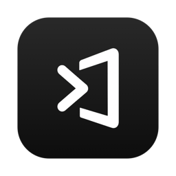
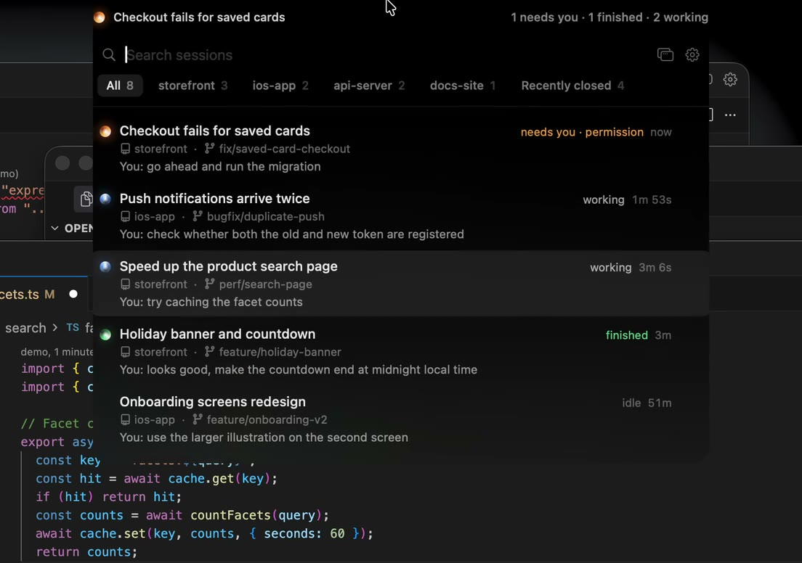
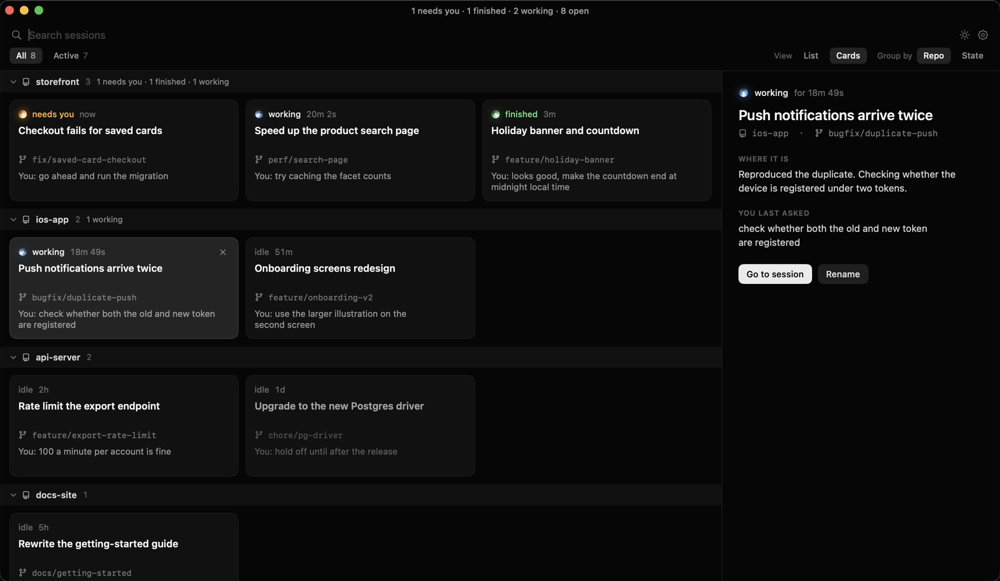
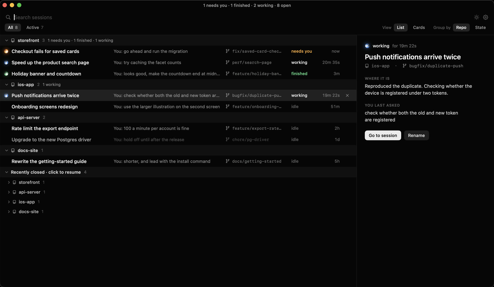

<p align="center"></p>

<h1 align="center">codehatch</h1>

<p align="center">Every coding session, one click away.</p>

<p align="center"></p>

codehatch is a small Mac app for people who run several Claude Code and Codex sessions at once. Push the pointer into the
notch (or press ⌥ Space) and a panel drops down with every session: what it is working on, whether it is working, finished
or waiting on you, its branch, and the last thing said in it. Click one and you are on its exact terminal tab. Close a
session, or restart your Mac, and it is still in the list, ready to resume.

Beside the notch, an orb shows the most urgent thing going on: amber when a session needs you, green when one has just
finished, blue while one is working.

<p align="center">
  
  
</p>

The same sessions can be popped out into their own window, as cards or as a list, and parked on a second monitor.

## Where it works

| | Cursor and VS Code | Terminal and iTerm2 |
|---|---|---|
| See every session: state, branch, last message | ✓ | ✓ |
| Go to a session | Lands on its exact terminal tab | Lands on its exact tab |
| Highlight the session you are in | ✓ | ✓ |
| Resume a closed session | In a new terminal tab, in the right project | In a new tab or window, in the right folder |

Cursor and VS Code need a small helper extension, which codehatch offers to install the first time it runs.

## Private by design

codehatch runs entirely on your Mac. It reads the session records Claude Code and Codex already keep in your home folder,
and the list of running programs. There is no account, no server and no AI model, and nothing about your work leaves the
machine. Its one network request is a daily check for updates, which can be turned off.

On first run it offers to add two small pieces, both plain files you can read and both removable in settings:

- **Hooks** in Claude Code and Codex, so it learns the moment a session starts, stops or needs you. They record the event
  only, never your prompts or replies. A copy of each settings file is saved first.
- **A helper extension** in Cursor and VS Code, so it can land on the exact terminal tab.

## Building it

Needs macOS 14 or later and Xcode 16 or later.

```sh
cd app
./run.sh            # build, and start it
./run.sh --widget   # and open the stay-on-screen window
```

| Folder | What is in it |
|---|---|
| `app/Sources` | The app (Swift, SwiftUI and AppKit) |
| `app/editor-helper` | The helper extension for Cursor and VS Code |
| `app/hook` | The hook script Claude Code and Codex run |
| `app/tests` | The tests (see below) |
| `app/release.sh` | Builds, signs and packages a release, and writes the update feed |
| `docs` | How it works, and images |

## Tests

```sh
cd app
python3 tests/run.py            # about a minute; opens nothing
python3 tests/run.py --apps     # also drives the real Terminal, iTerm2 and VS Code
python3 tests/run.py --live     # also starts real Claude Code and Codex sessions
```

Every test works in a throwaway folder under `~/.codehatch-tests`, made fresh and removed afterwards.

## Licence

MIT. See [LICENSE](LICENSE).
