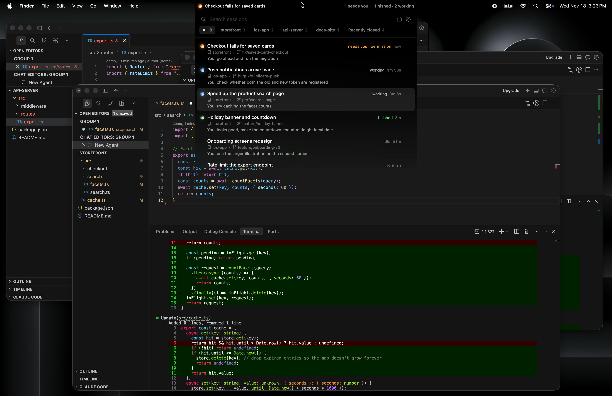
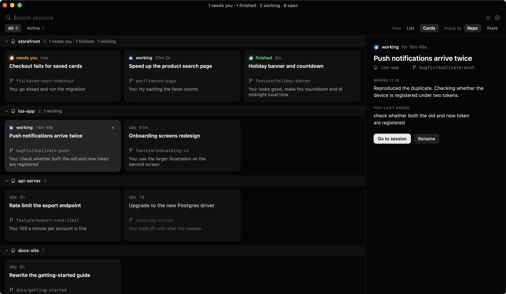
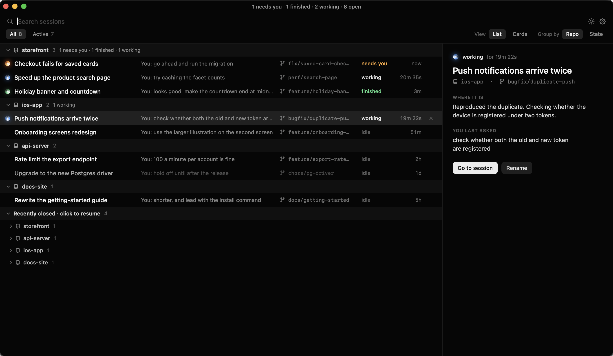

# codehatch

**Every coding session, one click away.**

A Mac app for people who run several **Claude Code** and **Codex** sessions at once. Push the pointer into the notch and
a panel drops down with **every session**: what it is working on, whether it is working, finished or waiting on you, and
the last thing said in it. Click one and you are on its exact terminal tab.

Close a session, or restart your Mac, and it is still in the list, ready to resume where you left it.

## Table of Contents

- [Get started](#get-started)
- [What it does](#what-it-does)
- [Where it works](#where-it-works)
- [Privacy](#privacy)
- [Make it yours](#make-it-yours)
- [Updating](#updating)
- [License](#license)

## Get started

You need a Mac with macOS 14 or later, and [Claude Code](https://code.claude.com/docs/en/setup) or
[Codex](https://developers.openai.com/codex).

1. Download codehatch from the [latest release](https://github.com/nykooi1/codehatch/releases/latest) and drag it to
   Applications.
2. Open it. A welcome window offers three things, all ticked: **live updates** (small hooks in Claude Code and Codex),
   **a helper** for Cursor or VS Code if you have them, and **open at login**. Choose **Set up**.
3. Push the pointer into the notch, or press **⌥ Space**.

If you use Codex, type `/hooks` in a Codex session once and trust codehatch's hooks. The first time you jump to a
session in Cursor or VS Code, the editor asks whether the helper may open the link; say yes.

## What it does

**Beside the notch**, an orb shows the most urgent thing going on:

| Orb | Means |
| --- | --- |
| Amber | A session needs you: it is waiting for a permission or an answer. |
| Green | A session just finished, and you have not been back to it yet. |
| Blue | A session is working. |

**Open the panel** to see every session, most recent first. Search, filter by repo, or pick a recently closed session to
resume it in a new terminal in the right folder.

**Pop it out** into its own window, as cards or as a list, and park it on a second monitor.

## Where it works

| | Cursor and VS Code | Terminal and iTerm2 | Any other editor or terminal |
| --- | --- | --- | --- |
| See every session: state, branch, last message | ✓ | ✓ | ✓ |
| Go to a session | Lands on its exact terminal tab | Lands on its exact tab | Brings the app to the front |
| Highlight the session you are in | ✓ | ✓ | – |
| Resume a closed session | In a new terminal tab, in the right project | In a new tab or window, in the right folder | In Cursor, VS Code, Terminal or iTerm2, whichever you choose |
| Close a session from the list | ✓ | ✓ | ✓ |

Other editors built on VS Code, such as Windsurf, use the same helper, but are not tested yet.

## Privacy

codehatch runs entirely on your Mac. It reads the session records Claude Code and Codex already keep in your home folder,
and the list of running programs. No account, no server, no AI model, and nothing about your work leaves the machine.
Its one network request is a daily check for updates, which you can turn off.

Setup adds two small pieces outside the app, both plain files you can read and both removable in settings:

- **Hooks** in Claude Code and Codex, so codehatch learns the moment a session starts, stops or needs you. They record the
  event only, never your prompts or replies. A copy of each settings file is saved first.
- **A helper extension** in Cursor and VS Code, so codehatch can land on the exact terminal tab.

More detail in [How it works](docs/how-it-works.md).

## Make it yours

Everything is in **Settings**, from the gear in the panel or the menu bar icon:

- Show the session's name or its state beside the orb, or just the orb.
- Order the panel by recency, or group it by repo.
- Hide repos you do not want listed, such as client work while you share your screen.
- Choose how long recently closed sessions stay listed.
- Light or dark for the window; cards or list; group by state or repo.

To quit, use the menu bar icon or **Quit codehatch** in settings. Your sessions keep running.

## Updating

codehatch checks for updates once a day and offers to install them. To check now, choose **Check for updates…** in the
menu bar icon.

Claude Code and Codex change how they work from time to time, so keeping codehatch up to date keeps it reading them
correctly.

## License

[MIT](LICENSE). You can use, modify, and share this software, including commercially. Keep the license notice with
copies. The software comes without a warranty.

Building it yourself, and running the tests, is covered in [Development](docs/development.md).
